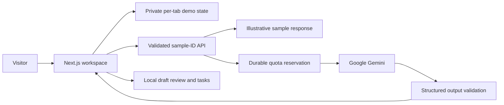

<div align="center">

# Lizz

### Less inbox. More possibility.

An AI email operations workspace that turns conversations into useful details, thoughtful drafts, and clear next steps.

**[Explore the live demo](https://lizz-ai.vercel.app/demo)** · **[Visit the website](https://lizz-ai.vercel.app/)** · **[Screenshots](docs/SCREENSHOTS.md)** · **[Architecture](docs/ARCHITECTURE.md)**


</div>

[](https://lizz-ai.vercel.app/demo)

## The idea

Business inboxes contain more than messages: quote requests, support issues, product questions, and follow-ups all need a next step. Lizz brings those details together, uses business context to suggest a reply, and keeps human review at the center of the workflow.

Explore the live demonstration without creating an account or connecting an email provider. Every Northstar organization, person, conversation, document, and price shown is fictional.

**Release status:** the public demo is live. Real customer workspaces, signup, and production integrations are not available in this release. This source repository remains private.

## What you can explore

| Experience              | What works in the public demo                                                                                |
| ----------------------- | ------------------------------------------------------------------------------------------------------------ |
| **Inbox**               | Browse and search seven fictional conversations; filter messages by processing or review state.              |
| **AI studio**           | Run live Gemini classification, structured extraction, source selection, and contextual response generation. |
| **Drafts & approvals**  | Edit suggested replies and simulate approval or rejection. No messages are sent.                             |
| **Tasks**               | Create tasks, assign fictional teammates, set priority, and change workflow status.                          |
| **Estimates**           | Adjust quantities, calculate a fictional subtotal, and export a draft as JSON.                               |
| **Knowledge**           | Inspect the four fictional references available to the AI.                                                   |
| **Automations**         | Configure local rules for tasks, approval requests, and review flags.                                        |
| **Activity & settings** | Follow the session's activity, choose a response style, and reset the workspace.                             |

## A quick tour

1. Open the **[inbox](https://lizz-ai.vercel.app/demo?view=Inbox)** and select Jamie's studio furnishing request.
2. Choose **Run live AI** to classify the email, extract useful details, and draft a response.
3. Open a source document to inspect the reference behind the draft.
4. Edit the reply, then approve or reject it within the demo.
5. Explore tasks, estimates, and rules, then use **Start fresh** to reset your session.

Live inference has a shared daily budget and a per-network allowance. **Use sample response** provides explicitly labeled illustrative output when live inference is unavailable.

## Screenshots

### Inbox and contextual review


### Live AI studio

Captured from the deployed application after a real Gemini request. All records shown are fictional.


<details>
<summary><strong>Website and mobile previews</strong></summary>

#### Public website


#### Mobile workspace


</details>

[View the complete screenshot gallery →](docs/SCREENSHOTS.md)

## Engineering highlights

- **Structured AI output:** fixed fictional context, constrained JSON output, and Zod validation before rendering.
- **Human review:** model confidence and automation rules cannot authorize real sending or financial actions.
- **Bounded inference:** durable private Blob reservations enforce request ceilings before calling the provider.
- **Independent demo sessions:** per-tab state with schema validation, reset, and expiry checks on restoration.
- **Isolated deployment:** no original mailbox, database, scheduler, or integration modules in the public runtime.
- **Honest provenance:** live model results and deterministic sample responses are clearly distinguished.

## Architecture



| Layer                | Public runtime                                                       |
| -------------------- | -------------------------------------------------------------------- |
| Interface            | Next.js 16, React 19, TypeScript, CSS, Lucide icons                  |
| AI                   | Google Gemini Interactions API; default model: gemini-3.5-flash-lite |
| Validation           | Zod schemas for requests, responses, and restored state              |
| Inference safeguards | Private Vercel Blob quota markers, output limits, timeouts           |
| Hosting              | Vercel, Node.js 24, Singapore function region                        |
| Verification         | Vitest, Playwright, TypeScript, dependency and source checks         |

The four demo references are supplied as fixed context. The public demo does not run live vector retrieval or customer integrations.

## Run locally

**Prerequisites:** Node.js 24, npm, and access to this private repository.

```sh
git clone https://github.com/Shahyan360/ai-assistant.git
cd ai-assistant/public-app
npm ci
npm run dev
```

Open **http://127.0.0.1:3000**. Sample mode requires no database, provider account, or credentials.

For live AI, copy [public-app/.env.example](public-app/.env.example) to an ignored **public-app/.env.local**, then configure your own Gemini key, a new private demo Blob store, and fresh quota/cleanup secrets. See the [configuration reference](docs/ENVIRONMENT_VARIABLES.md). Never copy the original application's environment into the public runtime.

## Verify the public app

From **public-app/**:

```sh
npm run typecheck
npm test
npm run security:scan
npm run format:check
npm audit
npm run build
npx playwright install chromium
npm run test:e2e
```

Release verification on **October 25, 2026** recorded **31 passing unit/security tests**, **8 passing local desktop/mobile browser tests**, and **8 passing browser tests against production**. Live inference was verified through the deployed interface. The [implementation report](docs/IMPLEMENTATION_REPORT.md) records the evidence and limitations; these counts describe that release, not a live CI badge.

## Repository guide

```text
public-app/               Independently deployed Lizz website and demo
  src/app/               Public pages and the narrow demo API
  src/components/        Product interface and reusable components
  src/lib/               Fictional fixtures, AI boundary, quotas and local state
  tests/                 Unit/security and browser checks
docs/                    Architecture, setup, security and release evidence
  screenshots/           Screenshots containing fictional records only
.github/workflows/       Public-demo verification workflow
src/, prisma/, scripts/  Preserved original private application
```

The original application includes Prisma/MySQL, NextAuth, Redis/BullMQ, Qdrant, and provider workflows. Those modules remain separate from the public runtime and have not been converted into a verified multi-tenant customer product.

## Documentation

| Guide                                                  | Purpose                                                |
| ------------------------------------------------------ | ------------------------------------------------------ |
| [Architecture](docs/ARCHITECTURE.md)                   | Runtime boundaries, data flow, and isolation           |
| [Local development](docs/LOCAL_DEVELOPMENT.md)         | Install, configure, and run the demo                   |
| [Environment variables](docs/ENVIRONMENT_VARIABLES.md) | Configuration without secret values                    |
| [Demo behavior](docs/DEMO_MODE.md)                     | Fixtures, session state, reset, and disabled actions   |
| [Integration status](docs/INTEGRATIONS.md)             | What is connected, simulated, or unavailable           |
| [Deployment](docs/DEPLOYMENT.md)                       | Vercel deployment and recovery                         |
| [Security](SECURITY.md)                                | Reporting guidance and implementation notes            |
| [Release evidence](docs/IMPLEMENTATION_REPORT.md)      | Tests, live inference, deployment, and incomplete work |
| [Screenshot gallery](docs/SCREENSHOTS.md)              | Product views with clear captions                      |
| [Contributing](CONTRIBUTING.md)                        | A safe workflow for repository collaborators           |

## Current boundaries

The demonstration does not send email, create financial transactions, accept customer documents, or connect Zoho/Gmail accounts. Customer authentication, organization tenancy, invitations, production RAG, billing, and tenant-aware workers require a separate release.

The original repository and its history remain private. Do not publish the full source tree, company records, old configuration, or client-owned assets without the review described in the [sanitization report](docs/PRIVACY_AND_SANITIZATION_REPORT.md). No open-source license is granted by this README.

---

**[Meet your calmer inbox →](https://lizz-ai.vercel.app/demo)**
