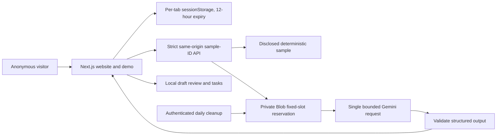

# Architecture

## Public runtime

`public-app/` runs Next.js 16.4.3 / React 19.3.1 / TypeScript on Vercel Node.js functions. It has a separate lockfile and a deliberately narrow dependency graph. No Prisma database, Redis client, Qdrant client, auth adapter, Zoho adapter, scheduler or legacy module is imported into this runtime.

Public POST requests accept only a fixed email ID, a preset tone and `live`/`sample` mode. Extra fields, arbitrary text, model names, tools and actions are rejected. Gemini receives only authored synthetic fixtures. There are no outbound-email or financial endpoints. Model output is rendered as React text, never as arbitrary HTML. A model cannot change permissions or approval requirements because no tool execution layer exists.

Quota storage is a newly created private Blob store, not a business database. Each call must create a previously unused fixed slot with `allowOverwrite:false` and `addRandomSuffix:false` before contacting Gemini. There are at most 40 global slots/day by default; configuration cannot raise this above 100. Slots are never refunded. Conflicts and storage failures fail closed. Daily keyed network hashes support a separate visitor limit. Cleanup never removes slots from the active day.

## Isolation

Demo session objects are constructed independently and persisted only in the current tab. Reset and expiry replace the object. There is no public API for reading another visitor's state. Shared durable storage contains quota markers only, not email records, generated drafts or edited tasks. This is demo isolation, not implemented customer tenancy.

## Legacy boundary and future customer release

The root app retains Prisma/MySQL, NextAuth credentials login, BullMQ, Redis, Qdrant and provider workflows. Its schema uses globally scoped records and its tenant helper returns a shared workspace. Do not activate that runtime for public customers. A customer release needs enforced organization ownership, composite constraints, membership/role checks on every operation, tenant-filtered vector retrieval, trusted tenant jobs, separate credentials, tested migrations and verified OAuth lifecycle. These have not been implemented by the narrowed public-demo release.
