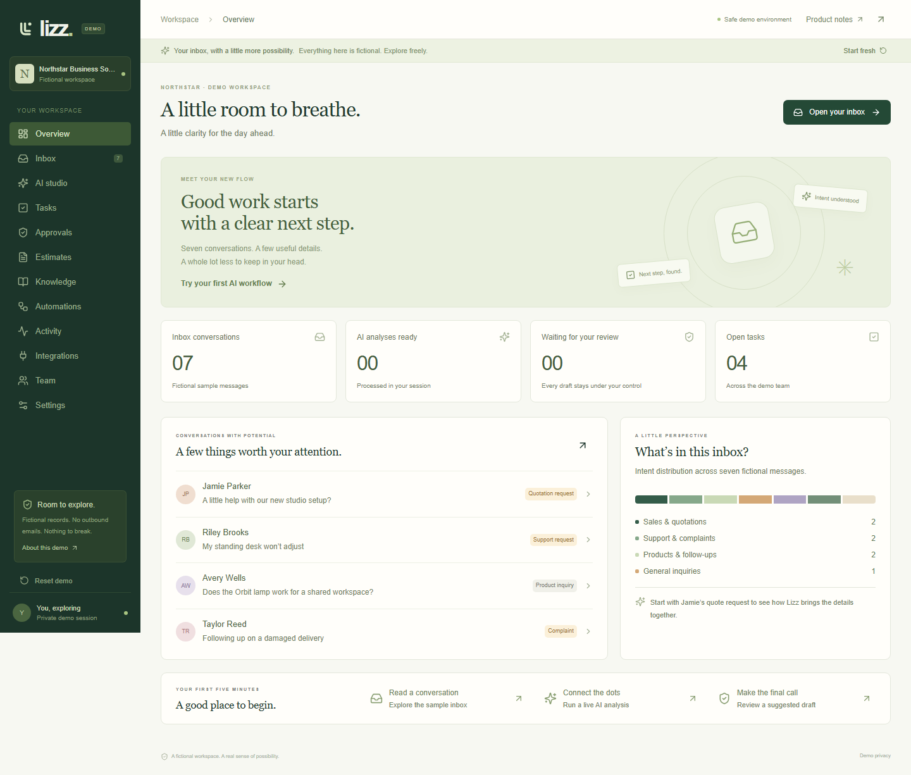
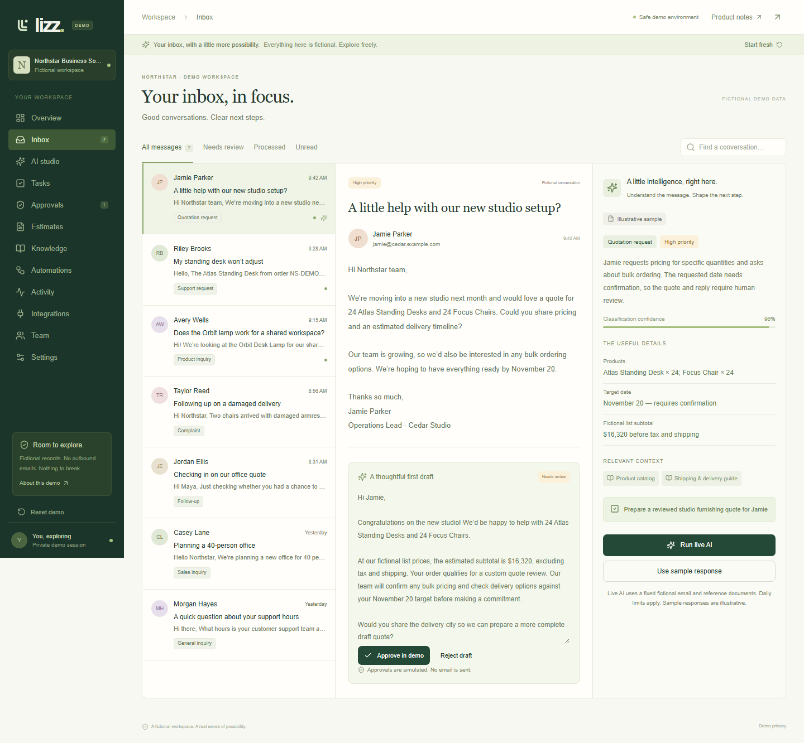
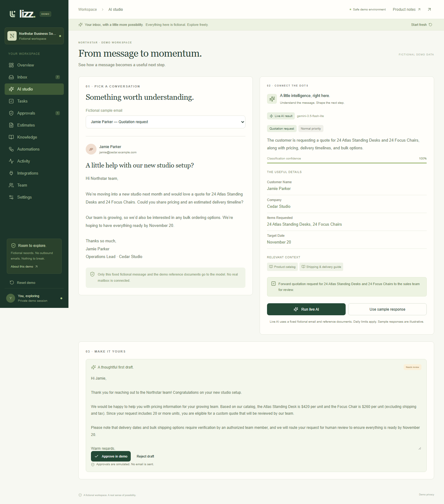
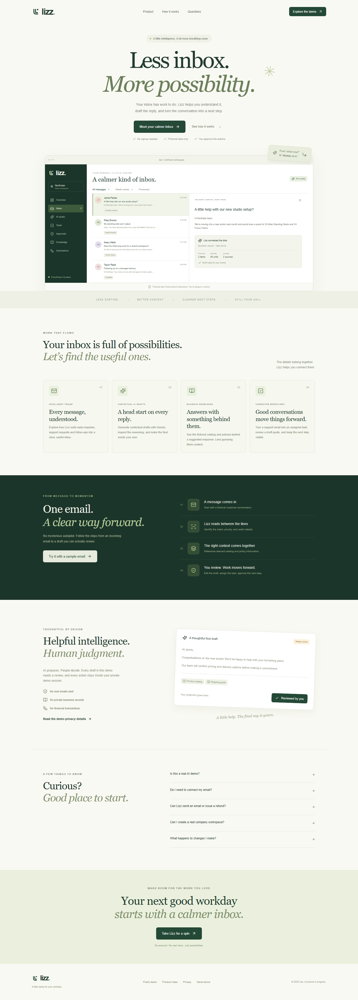
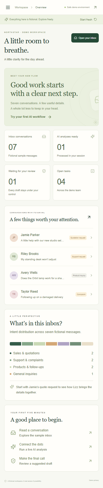

# Lizz screenshot gallery

**[Website](https://lizz-ai.vercel.app/)** · **[Live demo](https://lizz-ai.vercel.app/demo)** · **[README](../README.md)**

These captures show the Lizz demo released on October 25, 2026. Every organization, person, email, price, and document shown is fictional. No original client mailbox or account appears.

## Workspace overview

Sample conversations, session processing counts, review status, and fictional tasks in one place. Metrics describe demo records, not production usage.

## Inbox and review

A selected message sits beside an editable reply and a structured analysis. This capture uses an illustrative response, as labeled in the interface.

## Live AI studio

Captured from the deployed app after a real Gemini request. The result includes an intent, extracted fields, references, and a draft. Model confidence is not a measured accuracy claim.

## Public website

The product website introduces Lizz, explains its workflow, and opens the demo without signup.

## Mobile workspace

Responsive navigation and stacked content adapt the workspace to a narrow screen.

## Capture guidelines

Use only the isolated public demo. Reset before capturing its default state. Keep live/sample provenance visible. Never capture real mailboxes, account settings, provider credentials, or private business records.
